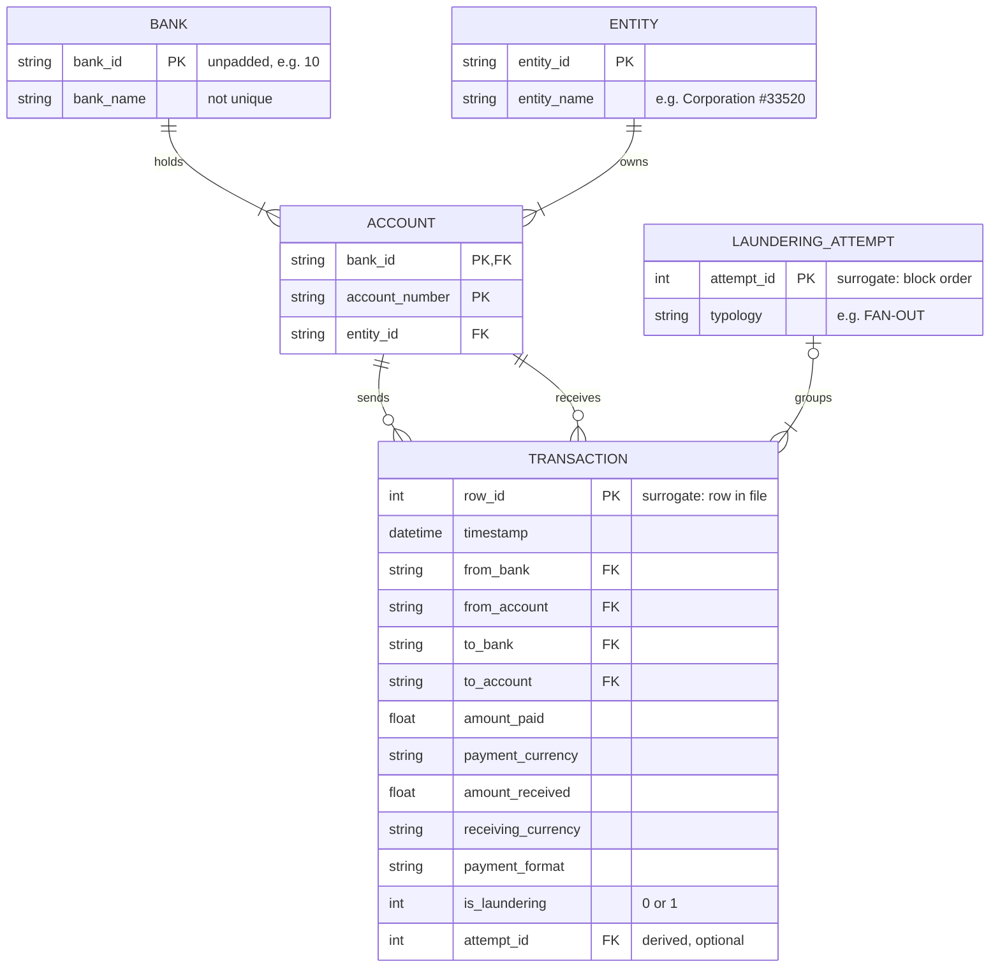

# Data

This folder holds the project's data locally. Nothing in it is committed apart from this README
and the `.gitkeep` placeholders; the files are downloaded by script.

## Source

The primary dataset is **HI-Small** from IBM's *Transactions for Anti Money Laundering (AML)*
dataset on Kaggle (`ealtman2019/ibm-transactions-for-anti-money-laundering-aml`), generated by
IBM's AMLworld simulator and described in Altman et al., *Realistic Synthetic Financial
Transactions for Anti-Money Laundering Models* (NeurIPS 2023, arXiv 2306.16424). Kaggle lists the
licence as the Community Data License Agreement - Sharing - Version 1.0.

"HI" means a higher illicit rate; the LI (lower illicit rate) datasets are a backlog item.

**The data is synthetic.** The simulator models banks, companies and individuals carrying out
ordinary financial activity over 18 days, with laundering schemes inserted, so every
laundering payment is known (see How the laundering flag is set).

## Getting the data

```bash
make data           # download into data/raw (skipping unchanged files), then validate
make validate-data  # re-run the validation checks only
```

Credentials are read from `~/.kaggle/access_token`, outside the repository. Each download is
recorded in `data/raw/manifest.json` with its SHA-256 hash, size and Kaggle creation date. Kaggle's
metadata carries no version number, so the creation date stands in for one.

| File | Bytes | Kaggle creation date | SHA-256 |
|---|---|---|---|
| `HI-Small_Trans.csv` | 475,664,283 | 2025-07-08 15:02:26 | `b19d39f515523373f991b689c07e11e7b0b95c17a2c27a87d91584ae16c5b040` |
| `HI-Small_accounts.csv` | 34,053,187 | 2025-07-08 15:02:20 | `786808526e33cfc441212dd6fccda7edfc24172149bed59c6ef59b186836b014` |
| `HI-Small_Patterns.txt` | 323,844 | 2025-07-08 14:59:17 | `2c546b5ce6009e73851f0139af053cf845f08bf92f3bc82fe1eb937dec2ef39b` |

Table 1. Downloaded files, as recorded on 24 October 2026.

## Structure

HI-Small has three files: transactions (what happened), accounts (who owns what) and patterns
(which transactions belong to which laundering scheme). Together they hold five entities; banks
and entities (account owners) have no file of their own and are derived from the accounts file.



| Relationship | Cardinality | Evidence |
|---|---|---|
| Bank holds account | Each bank holds one or more accounts; each account belongs to one bank | Every bank ID in the accounts file has accounts |
| Entity owns account | Each entity owns one or more accounts; each account has exactly one owner | No account has more than one entity ID |
| Account sends transaction | Each account sends zero or more transactions | 3,493 accounts never transact |
| Account receives transaction | Each account receives zero or more transactions | As above |
| Laundering attempt groups transaction | Each attempt groups one or more transactions; each transaction belongs to zero or one attempt | 3,209 pattern-file rows, all unique, each in one block |

Table 2. Relationships between entities and the checks behind them.

Four points about the model matter for later stages:

- **Transactions have no natural key.** No column or combination of columns is guaranteed
  unique (9 rows are exact duplicates; see Validation), so a row number serves as the
  identifier.
- **The link from a transaction to a laundering attempt is derived, not stored.** The patterns
  file repeats each transaction's full text, so the link is made by matching that text (see
  Patterns).
- **Bank names are not unique.** 468 bank names map to more than one bank ID, so `bank_id` is the
  only reliable bank key.
- **Entities can be large and span banks.** The median entity owns one account, but one owns
  7,820, and 63,362 entities hold accounts at more than one bank. Entity names carry a simulated
  type, e.g. Partnership, Corporation or Sole Proprietorship, not real customer attributes.

### Transactions

Each row is one payment from one account to another; there are 5,078,345 rows. An example row,
one step in a laundering cycle:

```
2022/09/03 10:20,0024856,8090E8EB0,0071,804ABCE90,637140.60,Rupee,637140.60,Rupee,ACH,1
```

| Raw column | Loaded as | Meaning |
|---|---|---|
| Timestamp | `timestamp` | Time of payment, to the minute (`%Y/%m/%d %H:%M`) |
| From Bank | `from_bank` | Sender's bank ID |
| Account (first) | `from_account` | Sender's account number |
| To Bank | `to_bank` | Receiver's bank ID |
| Account (second) | `to_account` | Receiver's account number |
| Amount Received | `amount_received` | Amount arriving, in the receiving currency |
| Receiving Currency | `receiving_currency` | Currency the receiver gets |
| Amount Paid | `amount_paid` | Amount leaving, in the payment currency |
| Payment Currency | `payment_currency` | Currency the sender pays in |
| Payment Format | `payment_format` | ACH, Cheque, Credit Card, Cash, Reinvestment, Wire or Bitcoin |
| Is Laundering | `is_laundering` | 1 if the payment is part of a laundering scheme, otherwise 0 |

Table 3. Transaction columns.

Two details of the raw file shape how it is loaded (`src/mule_detection/data/load.py`):

- **Two columns share the name `Account`**, so columns are named by position, and validation
  checks the header matches the expected order exactly before loading.
- **Bank IDs are zero-padded inconsistently** (e.g. `010` and `0010` both mean bank 10), so they
  are read as text and the padding is stripped to match the accounts file.

The amounts paid and received differ only when a payment converts currency. Reinvestment
payments move money between an account and itself.

#### How the laundering flag is set

**In this dataset,** the simulator sets `is_laundering` to 1 because it generated the payment as
part of a laundering scheme. The flag is therefore complete, immediate and certain.

**In a real bank, no payment carries a laundering flag when it happens.** A bank learns which
accounts were involved later, and only partly, through:

- **Investigated alerts:** an analyst reviews an alert from transaction monitoring and concludes
  the activity is suspicious, which can lead to a suspicious matter report to AUSTRAC.
- **Victim reports and recall requests:** a scam victim, or the victim's bank, reports that money
  was sent to an account.
- **Requests from law enforcement or intelligence partners** about specific accounts.
- **The bank's own actions,** e.g. restricting or closing an account for mule activity.

Real labels differ from this dataset's flag in five ways:

| Property | Real bank labels | AMLworld flag |
|---|---|---|
| Timing | Days to months after the payments | Known at the time of payment |
| Unit | Usually an account or a case | Each payment |
| Completeness | Accounts nobody investigated stay unknown, not "clean" | Every payment is labelled |
| Bias | Skewed towards what existing monitoring already detects | No detection bias |
| Certainty | A suspicious matter report records suspicion, not proof | Ground truth |

Table 4. Real-world labels compared with the AMLworld flag.

This gap is one reason results on this data are likely to overstate real-world performance (see
Limitations).

### Accounts

Each row is one account and its owner; there are 518,581 rows.

| Raw column | Loaded as | Meaning |
|---|---|---|
| Bank Name | `bank_name` | Simulated bank name, e.g. "Portugal Bank #4507" |
| Bank ID | `bank_id` | Bank ID, unpadded |
| Account Number | `account_number` | Account number |
| Entity ID | `entity_id` | Owner's ID; one owner can hold several accounts |
| Entity Name | `entity_name` | Simulated owner, e.g. "Corporation #33520" |

Table 5. Account columns.

### Patterns

The patterns file groups laundering transactions into 370 schemes ("laundering attempts").
Each block starts with a `BEGIN LAUNDERING ATTEMPT - <TYPOLOGY>` line, lists its transactions in
the same format as the transactions file, and ends with an `END LAUNDERING ATTEMPT` line.

| Typology | Attempts | Transactions |
|---|---|---|
| Bipartite | 49 | 263 |
| Cycle | 54 | 287 |
| Fan-in | 40 | 318 |
| Fan-out | 48 | 342 |
| Gather-scatter | 51 | 716 |
| Random | 41 | 191 |
| Scatter-gather | 44 | 626 |
| Stack | 43 | 466 |

Table 6. Laundering attempts by typology.

The patterns file is a partial record: it covers 3,209 laundering transactions, and the other
1,968 (38.01%) are flagged as laundering but sit in no block. The transaction flag, not the
patterns file, is the label source.

## Validation

`make validate-data` (also run by `make data`) first checks each file's SHA-256 hash (Table 1)
and, for the transactions and accounts files, the row count against the expected values in
`configs/data.yaml`, so a changed or truncated download fails. It then stops on any hard failure
in the content: an unexpected header, missing values, unparseable timestamps, non-numeric, zero
or negative amounts, labels other than 0 or 1, non-numeric bank IDs, duplicate account keys, a
transacting account missing from the accounts file, or a malformed pattern block. All checks
pass on HI-Small. It also reports:

| Check | Result |
|---|---|
| Duplicate transaction rows | 9 |
| Self-transfers (same sender and receiver account) | 591,212 |
| Bank IDs as written / after removing padding | 30,528 / 30,470 |
| Accounts appearing in at least one transaction | 515,088 |
| Accounts with no transactions | 3,493 |

Table 7. Reported (non-failing) validation results.

## Key characteristics

Figures from `notebooks/01_eda.ipynb`.

**How rare is laundering.** 5,177 of 5,078,345 transactions (0.1019%) are laundering.

**Transactions time period.** 1 to 18 September 2022, but normal activity stops after
10 September. The 8 days after that hold only 1,108 transactions, 655 of them laundering
(59.12%), which is 12.65% of all laundering. These appear to be laundering schemes completing
after the simulator's normal activity ends, so the tail is not a realistic evaluation period.
Within 1-10 September, weekends carry about 207,000 transactions a day against about 482,000 on
most weekdays.

**Payment formats and currencies.**
- ACH carries 86.59% of laundering but 11.83% of all transactions.
- Reinvestment and Wire carry no laundering.
- Saudi Riyal has a laundering rate of 0.4202%, about four times most other currencies.
- None of the 72,170 cross-currency transactions is laundering.

**Amounts.** The median laundering amount is 8,667.21 against 1,410.99 for normal transactions, in
mixed currencies, so this is a rough comparison only.

## Account labels

The data flags individual payments, but the project scores accounts, so each account gets a
label built from its laundering payments. The reasoning behind the rules is recorded in
`docs/decisions.md`; the rules themselves are below.

### Rules

**R1. Account.** An account is a bank ID plus an account number.
*Example:* account number `80A7FD400` appears at bank 27755 and at bank 28248; these are two
different accounts. Eight account numbers in HI-Small appear at more than one bank.

**R2. Laundering payment.** A payment whose laundering flag is 1 (see How the laundering flag is
set).
*Example:* on 10 September 09:59, account `10057:80C3B78E0` receives 1,870,505.26 yen in a
laundering payment.

**R3. Self-transfers.** A laundering payment from an account to itself is ignored, because it
neither receives money from nor passes money to anyone else.
*Example:* 11 laundering payments are self-transfers; ignoring them changes no label in
HI-Small.

**R4. Mule.** An account is a mule if it receives at least one laundering payment and sends at
least one laundering payment, in either order. Why order is ignored: `docs/decisions.md`
("Mule label returned to both directions, order ignored").
*Example:* `10057:80C3B78E0` receives on 10 September and sends on 11 September, so it is a mule.
`213952:806D47B10` is a middle account in a scatter-gather scheme, where money must arrive before
it is passed on, yet its send is timestamped 1 September 08:40 and its receipt 2 September 13:04;
it is also a mule.

**R5. Timing.** Each account records when it was first involved in laundering in each direction
and, for mules, when it first met R4: the later of its first laundering receipt and its first
laundering send.
*Example:* for `10057:80C3B78E0`, `first_laundering_at` is 10 September 09:59 and `mule_at` is
11 September 10:03. Between those two times the account had received laundering money but not
yet sent any.

**R6. Cut-off.** Labels built "as at" a point in time use only payments before it, so they show
what had happened by that point. Accounts whose first transaction is at or after the cut-off are
left out (R7).
*Example:* as at 11 September 00:00, `10057:80C3B78E0` is not yet a mule, and HI-Small has 795
mules among 515,078 accounts, instead of 1,003 among 515,088.

**R7. Population.** Every account that appears in at least one transaction (before the cut-off,
if one is used) gets a label.
*Example:* 515,088 accounts are labelled; the 3,493 accounts in the accounts file with no
transactions are not.

### Label columns

| Column | Meaning |
|---|---|
| `bank_id`, `account_number` | The account (R1) |
| `is_mule` | True if the account meets R4 |
| `mule_at` | When the account first met R4; empty for non-mules |
| `first_laundering_at` | First laundering payment in either direction; empty if none |
| `first_received_at`, `first_sent_at` | First laundering payment received and sent; empty if none |
| `laundering_received`, `laundering_sent` | Number of laundering payments received and sent |

Table 8. Columns in `data/processed/account_labels.parquet`.

### Accounts by laundering role

| Role | Accounts | Label |
|---|---|---|
| No laundering payments | 508,731 | Not mule |
| Send only | 2,373 | Not mule |
| Receive only | 2,981 | Not mule |
| Both directions, first receipt timestamped first | 862 | Mule |
| Both directions, first send timestamped first | 141 | Mule |

Table 9. Labelled accounts by role in laundering payments.

1,003 of 515,088 accounts (0.1947%) are mules. Their `mule_at` runs from 1 September 02:52 to
16 September 00:20, and 208 of them first meet R4 on or after 11 September, in the tail where
normal activity has stopped. The split by which direction is timestamped first is shown for
information only, since the timestamps do not reliably show the order money moved.

The roles describe where an account sits in the laundering flows, not facts the data records.
"Send only" accounts are likely where money enters a scheme. "Receive only" accounts are where a
scheme ends in the data, which could be a cash-out account or the criminal's own. Some
"both directions" accounts are not mules in the usual sense but the account where a scheme
starts and its money returns, e.g. the start of a cycle; the data cannot reliably tell these
apart from mules, so they are labelled mules.

### Building and exploring the labels

```bash
make labels     # build data/processed/account_labels.parquet from the raw transactions
```

In Python, `mule_detection.data.labels.load_labels()` reads the file with account keys as text
and timestamps as dates; `build_account_labels(transactions, as_at=...)` builds labels as at a
point in time. To browse the file, open it in VS Code with the Data Wrangler extension.

## Limitations

- **Synthetic data.** Laundering is generated from network patterns, so results on this data
  are likely to overstate what a model would achieve on real bank data, especially for graph
  features.
- **Simulator artefacts.** Some signals are cleaner than real behaviour is likely to be (see Key
  characteristics), and timestamps within a scheme do not follow the money (R4). Features built
  on them can learn the simulator rather than laundering.
- **Laundering in general, not scams.** There are no victim-side signals (scam reports, recall
  requests), which banks hold internally.
- **No customer attributes.** There is no age, occupation, income or account-opening date.
- **Perfect labels.** Real labels are later, less complete and less certain (Table 4).
- **Short, uneven window.** 18 days, with normal activity ending after 10 September, limits how
  far stability over time can be tested.
